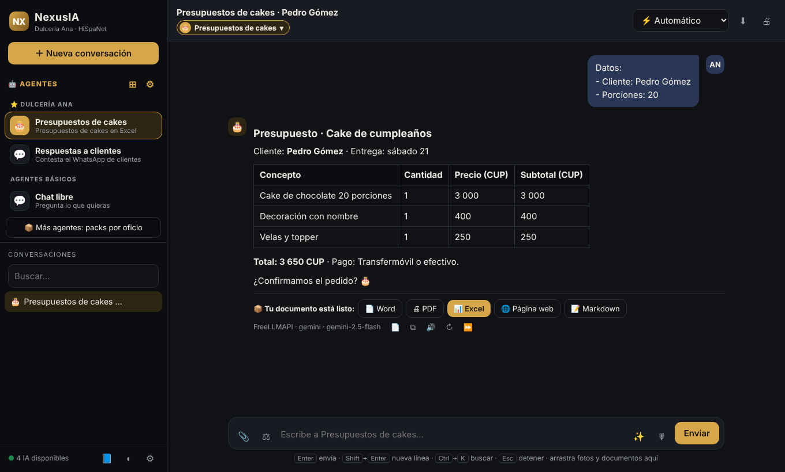

# NexusIA · Agentes de IA para tu negocio

**NexusIA** crea agentes de IA que trabajan para tu negocio con **tu información**: te piden los datos con un formulario, hacen el trabajo paso a paso y te entregan el resultado en **Word, PDF o Excel**. Funciona con **cientos de IA gratis** gracias a FreeLLMAPI, y con IA de pago solo si tú la activas.

🌐 **Página:** https://corderorauly-raullg57.github.io/nexoia/
⬇ **Descarga:** [NexusIA.zip](NexusIA.zip)

## Qué hace

| | |
|---|---|
| 📚 **Usa tu información** | Precios, catálogo, menú, manuales: responde con tus datos y no inventa |
| 📝 **Formularios** | Te pide los datos en casillas |
| 🔗 **Trabajo por pasos** | Analiza → redacta → revisa |
| 📄 **Documentos** | Word, PDF, Excel, página web o Markdown |
| 🧬 **Creador de agentes** | Describe tu negocio y la IA crea el agente |
| ⚡ **Motor automático** | Si una IA se queda sin créditos, pasa sola a la siguiente |

## Instalar (Windows 10/11)

1. Descarga **NexusIA.zip** y descomprímelo (clic derecho › Extraer todo).
2. Doble clic en **Instalar NexusIA.bat**.
3. Elige: **[1] Ligero** (recomendado) · **[2] Completo** (también sin internet) · **[3] Solo NexusIA**.
4. NexusIA se abre sola con el asistente de configuración.

## Guías

- 🚀 [INSTALACION.md](INSTALACION.md) — opciones, claves gratis y problemas
- 📘 [GUIA.md](GUIA.md) — cómo usar NexusIA
- 🧬 [CREAR-AGENTE.md](CREAR-AGENTE.md) — cómo crear agentes

## ¿Lo quieres listo para tu negocio?

Te preparamos NexusIA con tus agentes, tus precios y tu información, probado y listo para instalar con un doble clic.
💬 WhatsApp **+53 5508 1288** · **HiSpaNet**
